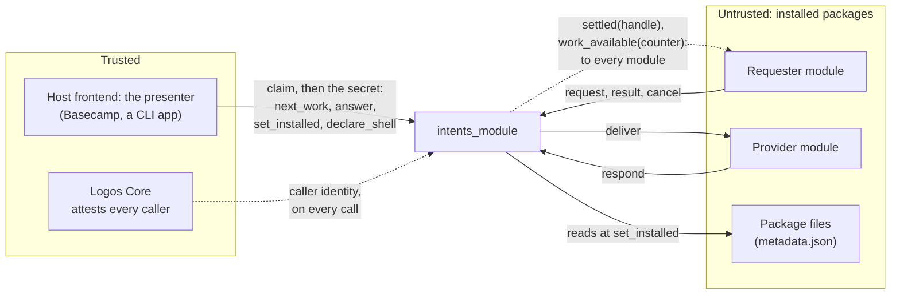

# intents_module security

What `intents_module` protects, what it relies on, and what it doesn't cover.
**MUST**, **SHOULD** and **MAY** are used as in RFC 2119. Numbers in parentheses
refer to the threats in [`design.md`](design.md#security).

## Scope

`intents_module` treats everything requesters and providers send it, and every
package's `metadata.json`, as untrusted: a package's module may call any method
with any arguments at any rate, answer as a provider however it likes, and pick
any name. Under the `logoscore` daemon every `logosctl` user calls as `Host`,
and isn't trusted either: once the host has claimed, a `Host` caller without the
secret can make neither a presenter call nor a request.

It relies on:

- **Logos Core** for who is calling. The requester and provider names it acts on
  are the core's attestation of the calling module, never something a caller says.
- **The host frontend** for the presenter's work, and for claiming that role
  first (see [Host requirements](#host-requirements)). The presenter, the host
  holding the secret, is trusted.
- **Package management** for what is installed: that a package's files are the
  ones that were signed, and that reserved names can't be installed.
- **The provider** for what a request does.

It provides no process sandboxing and no filesystem isolation. A native module
runs as the same OS user and can rewrite another package's files, its
`metadata.json` included; protecting against that takes platform controls.

It routes requests a person mediates; it isn't a permission system. Declaring an
intent makes a module eligible to ask for it or answer it, nothing more, and
picking a provider in the chooser approves nothing. The provider decides what a
request may do, and has the person confirm anything that matters (a signature,
a payment) in its own view, with the details in front of them.

## Enforced by the module

### Who is who

| Rule | Where | Test |
|---|---|---|
| The presenter role is claimed once, by a `Host` caller; no handover. The module can't tell which `Host` caller claims first: that is the host's to ensure ([Host requirements](#host-requirements)) (1, 13) | `IntentsService::claim` | `the_presenter_role_is_claimed_once`, `a_module_cannot_claim_the_presenter_role` |
| Every presenter method needs the secret **and** a `Host` caller | `presenterCall` | `every_presenter_method_needs_the_secret`, `the_secret_is_useless_to_a_module` |
| A `Host` caller can't request directly (under the daemon that is any `logosctl` user) | `requesterForCaller` | `a_host_caller_cannot_request_directly` |
| A module named like the shell, the link requester or an installed app is refused; shell and link requests are marked by the presenter's entry point, never by name | `requesterForCaller`, `IntentBroker::submit(fromPresenter)` | `a_module_named_like_the_link_requester_is_refused`, `a_module_named_like_the_shell_is_refused`, `a_module_named_like_an_app_is_refused`, `a_request_under_the_shells_name_is_the_shells_only_from_the_presenter` |
| `respond` only from the module the dispatch went to (6) | `IntentBroker::respond` | `respond_is_accepted_only_from_the_module_delivered_to`, `only_the_module_delivered_to_may_respond` |
| A result is readable only by the requester that asked, and only with its receipt; `settled` carries a handle only (2) | `IntentBroker::result` | `the_settled_event_carries_only_the_handle`, `another_module_cannot_read_a_result` |
| Every call is answered directly (single dispatch), so replies, the secret and results among them, are call replies and never completion events, which over the Qt transport every replica of a module receives (2) | `metadata.json` (no `concurrency`) | the `single-dispatch` flake check |
| A request lasts only while its requester declares the intent and may make it, checked again whenever the registry changes and right before delivery: one uninstalled or updated to drop the intent ends `not_declared`, one a new restriction leaves out `unavailable` (10) | `IntentBroker::registryChanged`, `requesterStillMay` | `a_requester_uninstalled_while_its_chooser_is_open_gets_nothing_delivered`, `a_requester_that_stops_declaring_the_intent_loses_its_open_request`, `a_requester_a_new_restriction_leaves_out_loses_its_open_request`, `nothing_is_delivered_for_a_requester_that_may_no_longer_ask`, `set_installed_ends_the_open_requests_of_a_requester_it_no_longer_lists`, `a_shell_declaration_ends_the_open_requests_its_restrictions_leave_out` |
| Each shell declaration replaces its restrictions whole; one whose `restricted` can't be read (not an object, an empty list) is refused and changes nothing | `IntentsService::declareShellLocked`, `IntentRegistry::setRestrictions` | `a_shell_declaration_replaces_its_restrictions_whole`, `restricted_intents_admit_only_their_requesters` |
| `logos.` and the shell's namespace can't be provided by a package, even one read before the shell was declared | `IntentRegistry` | `reserved_namespaces_are_refused_from_packages`, `a_late_shell_or_link_declaration_still_applies` |
| A package's `metadata.json` must carry the name the host registered; names are `[A-Za-z0-9_.-]{1,64}` | `IntentRegistry::rebuild`, `isValidPackageName` | `rebuild_reads_disk_and_checks_the_name`, `package_names_with_anything_but_plain_characters_are_skipped` |

### What the person sees

| Rule | Where | Test |
|---|---|---|
| A request for another module's intent waits as pending until the presenter opens it, and nothing is resolved before, so asking reveals nothing about what is installed. Three kinds don't wait: one for an intent the requester provides itself goes straight to it, with nobody else involved; the presenter's own requests and links start open; and a refusal (`not_declared`, a restriction, no presenter yet) settles without one | `IntentBroker::start` | `a_new_request_waits_until_the_presenter_opens_it`, `unopened_requests_reveal_nothing_about_what_is_installed`, `unopened_requests_wait_alike_whatever_is_installed`, `a_requester_providing_its_own_intent_skips_the_choice`, `a_shell_request_with_one_package_provider_still_asks`, `an_undeclared_intent_settles_not_declared_at_once` |
| Install offers only for opened requests, once per intent a minute | `offerInstall` | `install_offers_need_an_opened_request`, `an_install_offer_comes_once_opened_and_once_a_minute` |
| `unavailable` for absent, denied, unreachable and unloaded alike, never before 400 ms (16) | `failWithFloor` | `nothing_provides_it_is_unavailable_but_only_after_the_floor` |
| One provider isn't a reason to skip the chooser, for the shell's own requests too; only the shell as the provider is | `IntentBroker::start` | `a_shell_request_with_one_package_provider_still_asks` |
| One chooser at a time; one shown gets its full 10 minutes from when it's shown | `presentChoice`, `showChoice` | `only_one_choice_is_on_screen_and_the_next_follows`, `a_queued_choice_gets_its_full_time_once_shown` |
| A chooser lists the providers of the moment it's shown, not when it was queued, and a pick is delivered only if that provider is still allowed, still reachable by the requester (links: `web`) and its registry entry (metadata, display name, icon) is unchanged since it was shown; otherwise the person is asked again. The entry says nothing about the provider's files or its running instance ([Known limits](#known-limits)) | `showChoice`, `stillEligible`, `IntentRegistry::revisionOf` | `a_provider_changed_under_the_chooser_is_offered_again`, `a_queued_chooser_shows_the_providers_of_the_moment_it_comes_up`, `a_link_request_cannot_go_to_a_provider_that_dropped_web` |
| Names a presenter may draw are stripped of control, bidirectional, zero-width and line-separator characters (5) | `displaySafe` | `display_text_loses_control_characters`, `work_items_show_display_safe_names` |
| No method lists providers; choosers reach only the presenter (6) | API | — |
| Before a presenter claims, nothing is shown or delivered: every request is `unavailable` | `IntentBroker::start` | `nothing_is_delivered_before_a_presenter_claims` |

### Staying up

| Rule | Where | Test |
|---|---|---|
| JSON from outside is checked for size, nesting and value count before anything is built: payloads 1 MiB / 8 levels, manifests 1 MiB / 32 levels, `deliver` replies 64 KiB (a larger reply isn't an acceptance) | `parseBounded` | `json_past_its_limits_is_refused_before_it_is_built`, `deeply_nested_metadata_cannot_crash_set_installed`, `an_oversized_deliver_reply_is_not_an_acceptance`, `a_deeply_nested_deliver_reply_cannot_crash_the_module` |
| Nothing a caller sends is parsed until the caller is known to be entitled: a declared requester within its rate, the provider a dispatch waits on | `request`, `respond` | `a_response_from_a_stranger_reads_nothing` |
| At most 64 `provides` / `uses` entries and 32 params per entry per package; a manifest is read only if it is a regular file, and the open never waits (the host runs one call at a time, so a FIFO would stall everyone). A symlink is followed, since dev hosts lay dependencies out that way; what it points to must still name the package | `IntentRegistry`, `readManifest` | `a_package_declares_at_most_64_entries`, `a_huge_manifest_is_refused_quickly`, `web_opt_ins_do_not_slow_down_rebuilds`, `a_fifo_manifest_cannot_stall_set_installed`, `a_symlinked_manifest_is_read` |
| Per requester, the shell and links included: 20 requests at once and 5 a second, 16 open, 4 pending, 4 MiB of open params, 64 results and 4 MiB of results; 64 MiB of open params, 64 MiB of results and 1024 open requests in all. A refusal over these limits holds no open slot while it waits out the floor, and at most 1024 wait at once; past that they settle at once | `BrokerConfig`, `holdRefusal` | `requests_past_the_rate_are_refused_in_the_reply`, `the_presenters_own_requests_have_a_rate_too`, `the_open_request_limit_holds_while_refusals_wait_out_their_floor`, `refusals_waiting_out_their_floor_are_bounded`, `open_requests_stay_within_each_requesters_byte_budget`, `open_params_have_a_budget_across_every_requester`, `results_stay_within_each_requesters_byte_budget`, `results_stay_within_the_global_byte_budget`, `an_oversized_result_is_refused` |
| `not_declared` and rate refusals come back in the reply, with no event; `settled` never goes out inside the call that made the request. It is still only a hint, since events and replies travel apart: a requester reads `result` once after `request` returns | `IntentsService::request` | `undeclared_requests_raise_no_events`, `settled_is_never_sent_before_the_request_returns` |
| A delivery reply holds the service while it runs, from any thread; closing it (`aboutToUnload`, or the destructor) waits for the replies running and drops every later one | `IntentsService::close` | `the_service_waits_for_a_running_delivery_reply_before_it_goes`, `a_delivery_reply_after_close_is_dropped`, `a_delivery_reply_after_the_service_is_gone_is_dropped` |
| Work items someone must answer are never dropped from the queue, and there are never more of them than open requests; past 1000 items the oldest notice goes, then the oldest `result` or `dismiss` ([Known limits](#known-limits)). Items that end before they're pulled are withdrawn, not answered with `dismiss` | `pushWork`, `dropWorkTarget` | `the_work_queue_stays_bounded_when_the_presenter_stops_pulling`, `withdrawn_requests_cannot_crowd_out_another_apps_chooser`, `a_flood_of_notices_cannot_push_out_an_item_awaiting_the_person`, `the_work_queue_does_not_keep_withdrawn_payloads` |
| Presenter input is read with checked reads, and an answer changes nothing unless it is valid; any exception that still escapes becomes a refusal | `answer`, `claim`, `guarded` | `a_malformed_presenter_answer_changes_nothing`, `a_shell_answer_with_a_null_error_completes` |
| Every log line is one line: untrusted text is escaped and truncated, payloads are never logged (8) | `forLog` | `log_fields_stay_on_one_line`, `an_intent_name_cannot_forge_log_lines`, `metadata_cannot_forge_log_lines` |
| A provider's answer must fit the `result` it declared (required fields, declared types; others pass), or the requester gets `failed` | `IntentBroker::resultViolation` | `an_answer_that_misses_its_declared_result_is_failed`, `a_provides_entry_describes_its_result_like_its_params` |
| A field declared with a type the module doesn't know (`boolean` for `bool`) is reported when the manifest is read, and its type isn't checked | `IntentRegistry::parseProvides` | `an_unknown_param_type_is_reported` |
| A provider can't mint `not_declared` / `unavailable` | `normalizeError` | `a_provider_cannot_send_back_a_broker_only_code_or_a_bad_payload` |

## Host requirements

What the module can't check, and a host running it must ensure.

- **Claim first, every time (1).** The host MUST load the module right after
  `capability_module` and claim before it loads any app or accepts `logosctl`,
  at startup and again after any restart of the module. The module accepts the
  first `Host` caller's claim and can't tell it from any other: besides the
  host, `capability_module` calls as `Host`, and so do Basecamp's in-process
  QML views on logos-protocol below 0.7 and, under the daemon, every `logosctl`
  user. A host whose claim is refused MUST NOT use the module, and SHOULD stop
  it: someone else is its presenter.
- **Reserve names (7, 9).** Installers MUST refuse packages named
  `intents_module`, like the shell or link requester the presenter declares
  (Basecamp: `main_ui`, `logos_link`), or like an app's backend
  (`<app>_backend`), bundled or not. The module refuses such a module as a
  requester, but the name must not be installable in the first place: a package
  installed first takes the name an app's backend asks and answers under.
- **Tell the module about every change.** The host MUST call `set_installed`
  after each install or uninstall, before the new package loads, listing every
  app's backend as the module it is, read from the `metadata.json` its app
  ships for it, whether or not it has run yet.
- **Restrict the shell's confirm intents.** The host MUST list every `confirm_*`
  intent under `restricted`, naming the Package Manager's backend module
  (`package_manager_ui_backend`), in every declaration: each one replaces the
  last whole. Any package that declares a shell intent may ask for it otherwise.
- **Interrupt only on a click (4).** A graphical host MUST open a pending
  request at once only on a real click or key press in the requesting module's
  own screen, the one the host loaded it for, once per input and within about
  2 s, and MUST leave every other request pending until the person opens it. A
  terminal presenter, which already has the person's attention and shows one
  request at a time, MAY open every request. A graphical host that opens every
  request lets any declared module interrupt the person. Basecamp opens at once
  only requests from packages the person trusts: see [Known limits](#known-limits).
- **Show who is asking (5).** The presenter MUST show the module name beside
  every display name, SHOULD show who signed the package, and MUST treat
  `iconSource` as untrusted. It MUST NOT take input on a chooser drawn in the
  place of one just cancelled.
- **Start what the person picks.** Before answering `choose`, the host SHOULD
  start the chosen module, or the app it belongs to; a provider that isn't
  running fails as `unavailable`.
- **Let the module reach app backends.** A host that restricts who may call an
  app's backend MUST let `intents_module` call it (Basecamp:
  `PluginLoader::restrictBackendToView`), or every delivery to an app fails as
  `unavailable`.
- **Run a protocol that reserves the completion channel (2).** Hosts SHOULD run
  a logos-protocol that keeps `__logos_call_complete__` off the event surface:
  since 8bdb552 (2026-09-10), marked by `LOGOS_PROTOCOL_HAS_RESERVED_EVENT_NAMES`.
  The version number still reads 0.9.0 either side of it, so only the macro
  tells, and no host checks it today. The module's own replies never ride that
  channel ([Who is who](#who-is-who)); a provider answering `deliver` deferred
  does, with nothing in it but whether it took the request.
- **Remote transport (3).** Callers are identified by their token on every
  transport, so the module's checks hold over `tcp` too; but the secret and
  results travel in call replies, so a module reachable beyond the machine MUST
  use `tcp_ssl`.

## Provider and requester requirements

What the module routes, but each module on either end must handle.

**Providers:**
- A provider MUST accept `deliver` only from `intents_module`
  (`logos::currentCaller().isModule("intents_module")`); the glue
  logos-module-builder generates for an app's backend already does.
- A provider MUST check the params itself before acting on them. The module
  checks only the shape the provider declared in `provides[].params`: required
  fields and known types; undescribed fields and unknown types pass.
- A provider MUST have the person confirm anything that matters (a signature, a
  payment, an install) in its own view, with the details in front of them,
  before doing it. Being picked in the chooser approves nothing.
- A provider SHOULD answer `deliver` within 5 seconds: `{"ok":true}` when it
  takes the request, `{"ok":false}` to refuse it.
- A provider learns that a request ended (cancelled, past its deadline, its
  requester gone) only when its `respond` is refused; nothing tells it before.
  It SHOULD keep every irreversible step behind the person's confirmation, and
  treat a refused `respond` as "nobody is waiting".

**Requesters:**
- A requester MUST treat a result's `data` as input from an unknown provider:
  it doesn't know which one the person picked, and the module checks only the
  shape that provider declared in `provides[].result`.
- A requester SHOULD read `result` once right after `request` returns, and
  again on each `settled(handle)`: the event is a hint, and can arrive before
  the reply.
- After `intents_module` restarts, a requester's open handles answer
  `unknown_handle`; it MUST treat them as failed. Whatever a provider already
  did stays done.

## Known limits

Each limit says what kind it is and where it stands: open (to fix), accepted
(a residual risk), or a dependency on another part of the platform.

| Limit | Kind | Status |
|---|---|---|
| **Events reach every module.** `work_available(counter)` and `settled(handle)` carry no content, but show how busy the person is and when requests finish. Once a request is opened, a provider adds a chooser where none adds at most one install offer a minute, so the 400 ms floor doesn't hide what is installed. | Privacy | Open: needs events scoped to their recipient, which the transport doesn't offer (a module's events reach every replica). |
| **Trusted packages interrupt without a click.** Until its pending list ships, Basecamp opens a request at once when the package asking ships with Basecamp or a publisher the person trusts signed it, a core module's with no screen too, and up to 16 choosers can queue. Any other waits for a click in its own screen, or expires unseen. Basecamp's QML intent path opens every request from apps' screens. | Temporary | Accepted until Basecamp's Activity view shows the pending list. `--intents-attention interactive` opens only what the person clicked for. |
| **Presenter results can be lost.** Past 1000 queued work items with no notice left to drop, the oldest `result` or `dismiss` goes, so while the presenter isn't pulling, the answer to the shell's own request can be lost. | Defect | Open: the fix keeps results by handle for the presenter to fetch, a presenter-contract change. |
| **No cancellation reaches the provider.** Cancelling, a deadline or the requester's removal ends the request; a provider that already took it isn't told, and isn't stopped. | Execution lifecycle | Open: needs a provider-contract change. Until then, the provider requirements above. |
| **A provider that dies after taking a delivery** is noticed only at the request's deadline, up to 10 minutes. | Integration gap | Open: needs module lifecycle from the core (`modules_state`). |
| **The presenter claim rests on startup order.** Any `Host` caller that claims before the host does becomes the presenter, and the window reopens at each restart of the module. | Authentication | Open: needs a presenter credential from the core. Until then, a host requirement. |
| **A registry entry isn't an executable.** A pick is checked against the provider's registry entry, not its files or its running instance. | Platform dependency | Package management vouches for the files; the core names the running instance. |
| **Same-user processes.** A native module can rewrite any package's `metadata.json`; the registry trusts what is on disk at each `set_installed`, and a file on a FUSE mount the package controls can still block the read. | Platform dependency | Needs platform isolation. |
| **`--access-policy enforce` refuses every request and delivery:** they aren't dependency edges, as app → backend calls aren't either. | Integration gap | Open: a policy entry written by the frontend fixes both. |
| **Display names are labels the package picks.** Control, bidirectional and zero-width characters are removed; homoglyphs, tag characters, variation selectors and length are not. | Residual risk | Accepted; the presenter shows the module name ([Host requirements](#host-requirements)). |
| **Shared budgets.** Packages acting together can use up the 64 MiB of results (evicting anyone's oldest), the 64 MiB of open params or the 1024 open requests. Deliveries in flight to one provider aren't limited. | Residual availability risk | Accepted. |
| **Types the module doesn't know aren't checked.** A field declared as `boolean` passes any value; the registry reports it. | Validation | Accepted, so a newer type doesn't break an older module. |
| **Non-string `deliver` replies** are parsed by the SDK before the module sees them (and then count as not taken), so the 64 KiB limit applies only to string replies. | Validation | Accepted. |
